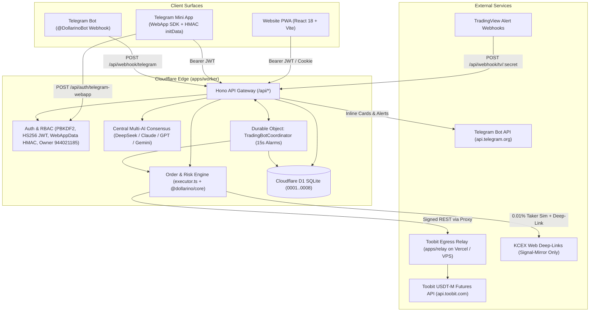
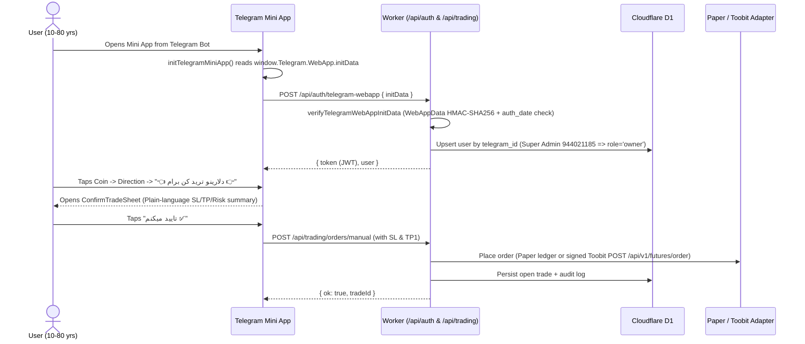

# System Architecture (`01-architecture`)

> All user interfaces — Website PWA, Telegram Bot, and Telegram Mini App — share a single stateless Hono API layer backed by Cloudflare D1 and stateful Durable Object alarms (`TradingBotCoordinator`).

---

## 1. High-Level Topology

---

## 2. Telegram Mini App + 2-Step Manual Trade Sequence

---

## 3. Core Architectural Invariants

1. **Zero Client-Side Secret Exposure**: Exchange API secrets, Telegram bot tokens, and platform AI keys never leave `apps/worker` after encryption into D1 (`MASTER_ENCRYPTION_KEY` + AES-256-GCM).
2. **Idempotent Bot Alarms**: `TradingBotCoordinator` runs every `15s` whenever at least one user has `bot_state IN ('RUNNING_PAPER', 'RUNNING_LIVE')` or an active `'OPEN'` trade in D1, reconciling 3-TP partial exits, break-even shifts, and dynamic trailing stops even when browser tabs are closed.
3. **Frontend Parity & Mode Persistence**: `uiMode` (`'simple' | 'pro'`) defaults to `'simple'` and persists in `localStorage['dollarino_ui_mode']`, allowing instant bidirectional switching without losing session state, open positions, or active chart symbols.
