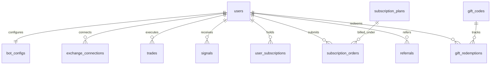

# Database Schema & Migrations (`03-database-and-migrations`)

> **Engine**: Cloudflare D1 (SQLite) · **Migrations Directory**: `/migrations/0001_init.sql` – `/migrations/0008_spec_and_miniapp_alignment.sql`

---

## 1. Migration Timeline

| Migration | Purpose |
|---|---|
| `0001_init.sql` | Core tables: `users`, `bot_configs`, `exchange_connections`, `telegram_bots`, `telegram_link_codes`, `signals`, `trades`, `audit_logs`, `system_settings` |
| `0002_strategy_flow.sql` | Strategy engine keys, timeframe filters, `pending_orders` table for LIMIT orders |
| `0003_kbos_and_wallet.sql` | `kbos_params_json`, paper wallet credit/reset fields, trailing stop metadata |
| `0004_strategy_v2_defaults.sql` | Hybrid Strategy Mixer weights (`mixer_weights_json`, `mixer_threshold`) & risk profile JSON |
| `0005_subscriptions.sql` | `subscription_plans`, `user_subscriptions`, `subscription_orders` + payment configs |
| `0006_dollarino_v01_and_platform_ai.sql` | Primary strategy `dollarino_v01`, `platform_ai_engines`, `platform_ai_signals`, `chart_ai_chats` |
| `0007_multi_coin_autonomous_trader.sql` | Multi-coin scanner fields (`scan_scope`, `auto_scan_top`, `watchlist_json`, `allow_auto_flip`) |
| `0008_spec_and_miniapp_alignment.sql` | `gift_codes`, `gift_redemptions`, `referrals` tables + plans aligned to `$20 / $50 / $90 / $160` |

---

## 2. Core Entities & Relationships

---

## 3. Master Spec Default Alignments (Enforced in `auth.ts` & `0008`)

- **New User `bot_configs` Defaults**:
  - `strategy_key = 'dollarino_v01'`
  - `margin_pct = 10`
  - `max_leverage = 10`, `max_open_positions = 6`
  - `tp1_close_pct = 50`, `tp2_close_pct = 25`, `tp3_close_pct = 25`
  - `auto_breakeven_on_tp1 = 1` (SL moves to Entry after TP1)
  - `move_sl_to_tp1_on_tp2 = 1` (SL moves to TP1 after TP2)
- **Subscription Pricing Alignment**:
  - `free_demo`: `$0` (365d Paper Demo)
  - `pro_monthly`: `$20` (30d)
  - `vip_quarterly`: `$50` (90d)
  - `pro_semiannual`: `$90` (180d)
  - `pro_annual`: `$160` (365d)
